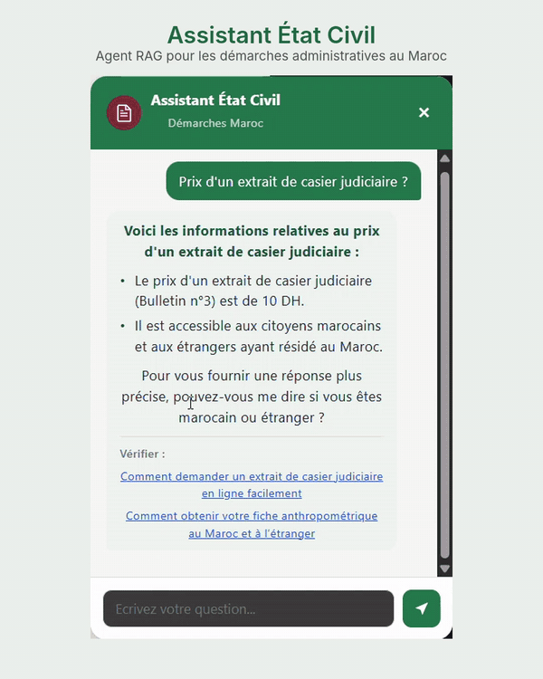
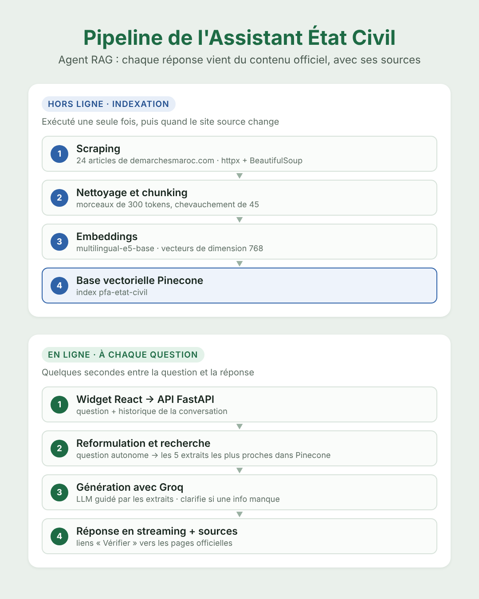

# Chatbot État Civil — Démarches Maroc

Chatbot conversationnel (RAG) répondant aux questions sur les démarches d'état civil marocaines
(acte de naissance, mariage, décès, livret de famille, divorce, casier judiciaire...), à partir du
contenu du site [demarchesmaroc.com](https://www.demarchesmaroc.com). Développé dans le cadre d'un
Projet de Fin d'Année (UIR).



*Démo (40 s) : l'agent répond avec ses sources, pose une question de clarification (marocain ou étranger ? majeur ou mineur ?) et renvoie vers la page officielle.*

## Fonctionnalités

- Réponses générées uniquement à partir de contenu officiel collecté et vérifié (pas d'invention)
- Agent conversationnel avec mémoire multi-tours : pose une question de clarification quand une
  information manque, plutôt que de répondre au hasard
- Réponses en flux continu (streaming), affichées progressivement
- Widget de chat intégrable, dans l'identité visuelle du site source

## Architecture



```
Site source -> Scraping -> Nettoyage -> Chunking -> Embeddings -> Pinecone
Question -> React -> FastAPI -> Pinecone (recherche) -> Groq/Llama -> Réponse
```

| Dossier | Contenu |
|---|---|
| `scraper/` | Collecte automatisée du contenu (httpx + BeautifulSoup) |
| `processing/` | Nettoyage et découpage du texte en chunks |
| `ingestion/` | Vectorisation et envoi vers Pinecone |
| `rag/` | Recherche vectorielle + génération de réponse (Groq/Llama) |
| `api/` | API FastAPI exposant le chatbot |
| `frontend/` | Widget de chat (React + Vite) |

## Prérequis

- Python 3.11+
- Node.js 18+
- Un compte [Pinecone](https://www.pinecone.io) (gratuit)
- Un compte [Groq](https://console.groq.com) (gratuit)

## Installation

```
python -m venv venv
venv\Scripts\activate
pip install -r requirements.txt

cd frontend
npm install
cd ..
```

## Configuration

Créer un fichier `.env` à la racine du projet (voir `.env.example`) :

```
PINECONE_API_KEY=votre_cle_pinecone
GROQ_API_KEY=votre_cle_groq
```

L'index Pinecone utilisé (`pfa-etat-civil`, dimension 768) contient déjà les données vectorisées
des 24 articles État Civil — aucune donnée n'a besoin d'être régénérée pour tester le chatbot, une
clé Pinecone valide pointant vers cet index suffit.

## Lancer le projet

**Windows (le plus simple)** : double-clic sur `demarrer.vbs` — démarre l'API et le frontend en
arrière-plan et ouvre le chatbot dans le navigateur.

**Manuellement** (nécessaire sur toute plateforme, ou si `demarrer.vbs` ne fonctionne pas) :

```
# Terminal 1
venv\Scripts\activate
python -m uvicorn api.main:app --host 127.0.0.1 --port 8000

# Terminal 2
cd frontend
npm run dev
```

Puis ouvrir `http://localhost:5173`.

## Vérifier que tout fonctionne

```
curl http://127.0.0.1:8000/health
```

Doit répondre `{"status":"ok"}`. Si le chatbot renvoie une erreur Pinecone (401), la clé API a
probablement expiré ou été révoquée — en générer une nouvelle sur le dashboard Pinecone et
mettre à jour `.env`.

## Régénérer les données (optionnel)

Nécessaire uniquement si le contenu du site source a changé ou si l'index Pinecone est vide :

```
python scraper/fetch_pages.py
python processing/clean_text.py
python processing/chunk.py
python ingestion/embed_and_upsert.py
```

## Technologies

Python, httpx, BeautifulSoup4, tiktoken, sentence-transformers (multilingual-e5-base), Pinecone,
Groq (Llama 3.3 70B), FastAPI, React, Vite.
